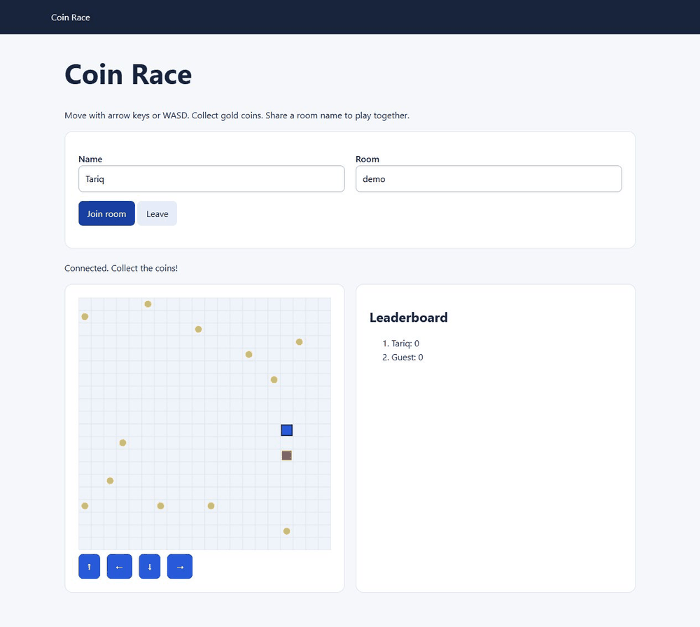

# Real-Time Multiplayer Game

A multiplayer game where players collect coins in the same room.



Recorded from the running Python app with two browser tabs.

## Try it in your browser

[](https://codespaces.new/TSalim22/realtime-multiplayer-game?quickstart=1)

Sign in to GitHub, open a Codespace and wait for setup. Then run this in its terminal:

```sh
python app.py
```

Open port 5000 from the **Ports** tab if the app does not open automatically.

Open the game in two tabs and use the same room name. To play with a friend, set port 5000 to **Public** in the Ports tab and share its URL. The link works while your Codespace is running.

Codespaces uses your GitHub account’s allowance. Stop it when finished.

## Run it

Python 3.12 or later. Run these commands from the project folder:

```powershell
python -m venv .venv
.venv\Scripts\Activate.ps1
python -m pip install -r requirements-dev.txt
python app.py
```

On macOS or Linux, activate with `source .venv/bin/activate` instead.

## How to use it

Open http://127.0.0.1:5000 in two browser tabs. Enter different player names and join the same room.

Use arrow keys, WASD or the buttons to move. Collect gold coins to score points. A room holds up to eight players. Scores reset when a player leaves.

The Python server handles movement and scores. Game state is kept in memory, so run one server process.

## Tests

```sh
python -m pytest -q
```

## Docker (optional)

```sh
docker build -t realtime-multiplayer-game .
docker run --rm -p 127.0.0.1:5000:5000 realtime-multiplayer-game
```

Docker hasn't been tested locally.
